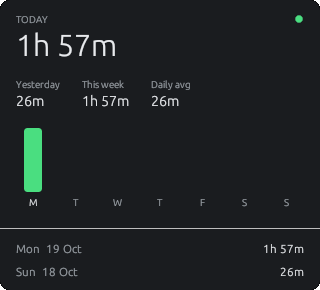

<div align="center">


# Sundial

**Tracks how long you're actually at your Windows PC each day.**

[](https://github.com/svk1998/sundial/releases/latest)
[](https://github.com/svk1998/sundial/actions/workflows/release.yml)
[](LICENSE)


<br>

<table>
  <tr>
    <td align="center" valign="top"><br><sub>Floating widget</sub></td>
    <td align="center" valign="top"><br><sub>Analytics: click the widget</sub></td>
  </tr>
</table>

</div>

Time counts while your session is unlocked and you've used the keyboard or mouse in the
last 5 minutes. Locking, sleeping, or walking away pauses it. Totals reset at midnight.

## Features

- Floating widget with today's total and a live status dot
- Analytics: yesterday, this week, daily average, and a 7-day chart
- Lives in the tray; optional start with Windows
- Local-only: no account, no network, one small JSON file
- Lightweight native Rust app (~3 MB)

## Install

Download **`sundial-vX.Y.Z-setup.exe`** from the [latest release](https://github.com/svk1998/sundial/releases/latest)
and run it. No admin rights needed; newer versions upgrade in place and keep your history.
A portable `.exe` is also available.

> Sundial isn't code-signed yet. If SmartScreen warns, choose **More info → Run anyway**.

Uninstall from **Settings → Apps → Sundial**.

## Usage

| | |
|---|---|
| **Drag** the widget | Move it |
| **Click** the widget | Open analytics |
| **Right-click** the widget or tray icon | Hide/show, analytics, start with Windows, quit |
| Status dot | 🟢 counting · 🟠 idle · ⚪ locked |

Hiding the widget doesn't stop tracking.

## How it counts

Presence is checked once a second against a monotonic clock. Walking away without locking
credits at most one idle timeout (5 min) before the clock pauses, so you never lose time
while reading. Gaps over 5 seconds (sleep, hangs) are discarded, and a crash loses at most
30 seconds.

History lives in `%APPDATA%\Sundial\data.json`. Change the idle threshold with
`idle_timeout_secs` there.

## Building from source

Requires the [Rust](https://rustup.rs) MSVC toolchain and Visual Studio Build Tools (C++ workload).

```sh
cargo build --release   # -> target/release/sundial.exe
cargo test
```

The installer is built from [`installer/sundial.iss`](installer/sundial.iss) with
[Inno Setup 6](https://jrsoftware.org/isinfo.php). Pushing a `v*` tag builds everything
and publishes a GitHub release.

> The renderer must stay on `glow`: the `wgpu` backend exits silently on this target.

## Contributing

Issues and pull requests are welcome. For larger changes, please open an issue first to
discuss what you'd like to change.

## License

[MIT](LICENSE)
